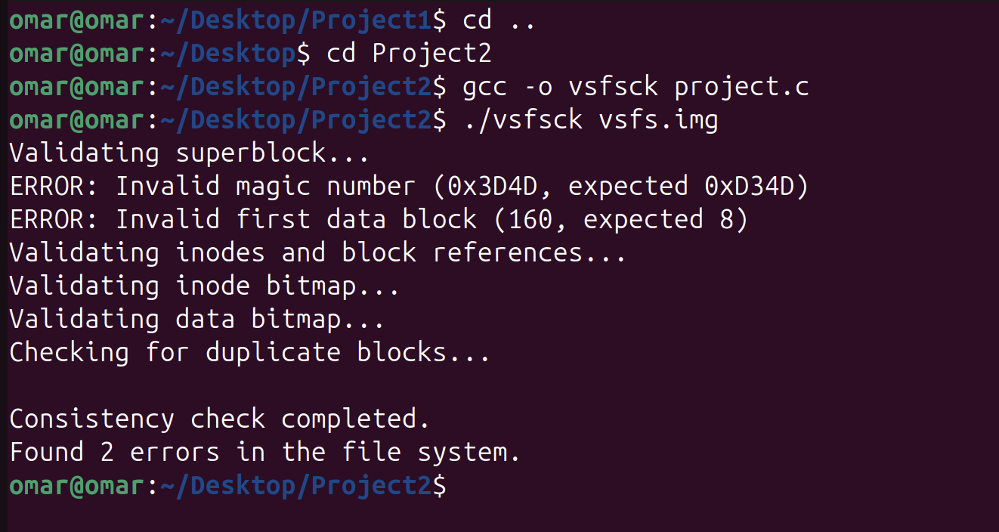

# VSFSck – File System Consistency Checker

A consistency checker for **VSFS (Very Simple File System)**, written in C.
`vsfsck` reads a file system image and checks the superblock, the inode and
data bitmaps, the inode table, and the block pointers. It reports every
inconsistency it finds, in the same spirit as the Unix `fsck` tool.

Made for CSE321 (Operating Systems) at BRAC University.



## File system layout

The checker works on a 256 KB image made of 64 blocks of 4096 bytes:

| Block(s) | Contents |
|----------|----------|
| 0 | Superblock |
| 1 | Inode bitmap |
| 2 | Data bitmap |
| 3–7 | Inode table (5 blocks × 16 inodes of 256 bytes = 80 inodes) |
| 8–63 | Data blocks |

Each inode stores the file's mode, owner, size, timestamps, link count, block
count, one direct block pointer, and single, double, and triple indirect
pointers.

## Checks

| Check | What it verifies | Function |
|-------|------------------|----------|
| Superblock validator | Magic number is `0xD34D`, block size is 4096, total blocks is 64, the inode bitmap, data bitmap, inode table, and first data block are at blocks 1, 2, 3, and 8, inode size is 256, and inode count is 80 | `validate_superblock()` |
| Data bitmap consistency | Every block marked used in the data bitmap is referenced by a valid inode, and every block referenced by an inode is marked used | `validate_data_bitmap()` |
| Inode bitmap consistency | Every inode marked used in the bitmap is valid (link count > 0 and deletion time = 0), and every valid inode is marked used | `validate_inode_bitmap()` |
| Duplicate checker | No data block is referenced by more than one inode | `check_duplicate_blocks()` |
| Bad block checker | Every block pointer falls inside the data block range (8–63). Non-zero indirect pointers are also flagged, since VSFS doesn't use them | `validate_inodes()` |

## How it works

1. Reads the whole image into memory and checks that it is exactly 64 × 4096 bytes.
2. Parses the superblock, both bitmaps, and the 80 inodes into C structs.
3. Walks every allocated inode and counts how many times each block is referenced.
4. Runs each check, printing an `ERROR:` line for every problem found.
5. Prints a summary. The program exits with status 0 if the file system is
   consistent and 1 if it found errors, so it can also be used in scripts.

## How to run

Requires `gcc` (Linux or macOS). Developed and tested on Ubuntu.

```bash
make
./vsfsck vsfs.img
```

Or without `make`:

```bash
gcc -o vsfsck vsfsck.c
./vsfsck vsfs.img
```

`make run` builds the checker and runs it on the included image.

## Result

The included `vsfs.img` is the corrupted image provided for the project.
The checker finds **2 errors**, both in the superblock:

| Field | Found | Expected |
|-------|-------|----------|
| Magic number | `0x3D4D` | `0xD34D` |
| First data block | 160 | 8 |

The image's bitmaps and inode table are empty, so the bitmap, duplicate, and
bad block checks pass on this image.

## Project specification

The original task is in [docs/project_specification.pdf](docs/project_specification.pdf).
